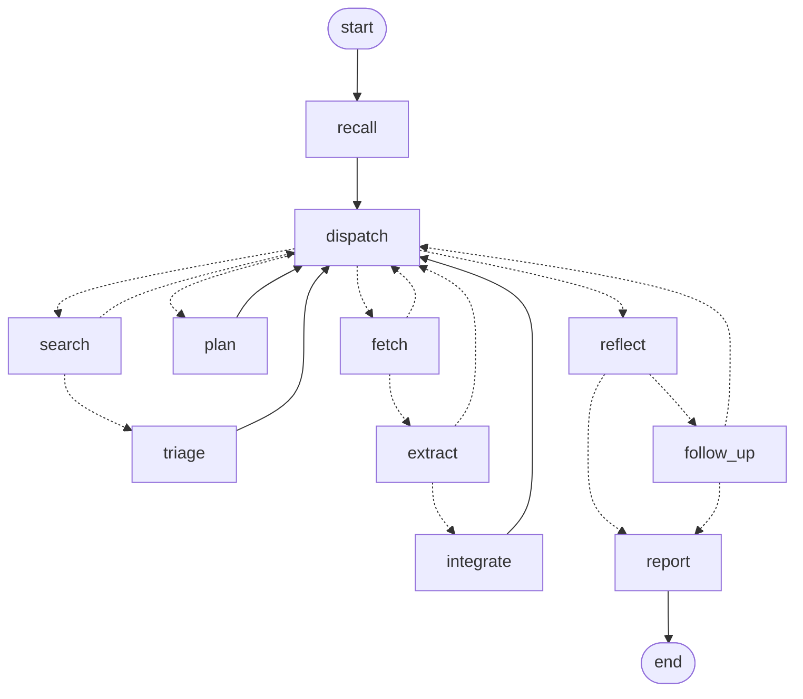

# LangGraph Architecture Decision

Date: 2026-10-12 · Branch: `experiment/langgraph` (local, not pushed, not merged) · LangGraph 1.2.14, `langgraph-checkpoint-sqlite` 3.1.1

## Decision

**KEEP CURRENT** — keep Forage's own session engine and do not make LangGraph the orchestrator now. **But change the engine**: move it to the step-by-step, resumable form built and verified in this evaluation. Full migration is not justified.

In one paragraph: running a session as separately checkpointed steps is clearly better than the current single-call engine. It survives crashes and stops without losing the session, and it can pause to ask a question. That benefit came from work on Forage's side (making session state restorable and steps safe to re-run), not from the framework. A 190-line loop over the same steps matched the LangGraph driver on every reliability test, with a smaller footprint. LangGraph adds real features (interrupts, retries, time travel, parallel branches, subgraphs, streaming), none of which Forage needs yet beyond what the loop already does. The LangGraph driver works, passes the same tests, and stays in the tree as an optional extra, so adopting it later is a configuration change rather than a migration.

LangGraph is **not clearly better** for Forage today. It is also not worse in any way that matters at Forage's scale. If you prefer to standardise on it for other reasons, option B below is viable and already prototyped; section 10 says when I would switch.

| Question | Answer |
| --- | --- |
| Is the current engine good enough as it is? | No. It loses the rest of a session on any interruption, and this evaluation found three defects in it (section 3). |
| Is a step-resumable engine better? | Yes, on measured reliability. Adopt it. |
| Does LangGraph do that better than a small custom loop? | No measurable difference in reliability. More features, more footprint. |
| Should scheduler, lifecycle, memory or policies move to LangGraph? | No. LangGraph has no equivalent for them. |

## 1. What was compared, and how

Three ways to drive one research session, all running **the same production step code**:

| Driver | What it is |
| --- | --- |
| `linear` | The current engine. One Python call runs the whole session; state lives in object attributes. |
| `langgraph` | The prototype. Each step is a node in a LangGraph `StateGraph` with a SQLite checkpointer. |
| `plain` | The same steps and the same control-flow table, driven by a small loop with its own checkpoint table. |

I added `plain` because without it the comparison could not separate two things: what Forage gains from *being step-resumable*, and what it gains from *LangGraph*. It supports only what the tests exercise (run, resume, one question to the user).

All comparisons use the simulated web and simulated model already in the repository, so differences are due to orchestration alone. One bounded live session used the real model and web (section 7). Everything is reproducible:

```bash
git checkout experiment/langgraph
.venv/bin/pip install -e ".[dev,langgraph]"
.venv/bin/python -m pytest                                   # 267 passed, 3 skipped
.venv/bin/python -m experiments.langgraph.compare all        # writes experiments/langgraph/results/*.json
FORAGE_TEST_ENGINE=langgraph .venv/bin/python -m pytest tests --ignore=tests/experimental   # existing suite, graph engine
```

## 2. LangGraph facts that matter here

Read from the official documentation on 2026-10-12 and checked against the installed source where noted.

| Topic | What the docs say | Consequence for Forage |
| --- | --- | --- |
| Checkpoints | "A checkpoint is a snapshot of the graph state saved at each super-step." | State is written once per node. Large state is written repeatedly. |
| Resume | A resumed node "restarts the entire node from the beginning"; node logic should be idempotent. | Every step with side effects needed re-run guards (section 5). The framework does not provide them. |
| Durability | `exit`, `async`, `sync`. Installed source defaults to `async`. `exit` cannot recover a process crash. | `sync` is the setting to use. Measured cost difference is small. |
| Interrupts | `interrupt()` needs a checkpointer and thread id, waits indefinitely, and re-runs the node on resume. Static interrupts are "not recommended for human-in-the-loop workflows". | Works well. The app still has to model a waiting session. |
| Retries | `RetryPolicy` per node: 3 attempts, 0.5 s initial, factor 2, jitter. | Useful, one line. |
| Timeouts | Async nodes only. Installed source rejects a sync node with a timeout: "sync Python execution cannot be safely cancelled in-process". | Forage's steps are synchronous. Time budgets stay application code. |
| SQLite checkpointer | Docs: "Ideal for experimentation and local workflows." Class docstring: "meant for lightweight, synchronous use cases (demos and small projects) and does not scale to multiple threads." | Forage runs one session at a time in one process, so these limits do not bind. |
| Stores | Key-value namespaces with optional semantic search, which needs an embedding model. Docs recommend Postgres, MongoDB or Redis stores for production. | Not a replacement for Forage's claims, sources and provenance tables. |
| Compatibility | "every change you ship is effectively a backward-compatible API change with respect to your existing checkpoints"; renaming or removing a node can break an interrupted thread. | Mild for sessions that live minutes. Real for a session parked for days on a question. |
| Functional API | `@entrypoint` and `@task`; resume replays the entrypoint and reuses saved task results. | Assessed from docs only, not prototyped. It would still need the same state restoration work. |

One open risk I could not settle: GitHub issue [langchain-ai/langgraph#8234](https://github.com/langchain-ai/langgraph/issues/8234), opened 2026-06-30 by an outside contributor and still open, claims that pending writes and checkpoints are not persisted in one transaction and that recovery can restore inconsistent state. No maintainer reply is shown on the issue, and part of its evidence is a screenshot. My tests did not reproduce any inconsistency (section 6.3), but they are small.

### What the reference projects gain from LangGraph

| | `langchain-ai/open_deep_research` | `LearningCircuit/local-deep-research` |
| --- | --- | --- |
| Status | Archived, read-only (GitHub API, last push 2026-08-10) | Active (pushed 2026-10-12) |
| How LangGraph is used | Three `StateGraph`s: main graph, supervisor subgraph, researcher subgraph. Routing with `Command`. Researchers launched with `asyncio.gather` over `researcher_subgraph.ainvoke`. | One strategy file of several (`langgraph_agent_strategy.py`) calls LangChain's prebuilt `create_agent`. Subagents run in a `ThreadPoolExecutor`. I did not read the other strategy files (source-based, focused iteration, news, topic organisation). |
| Who decides the next action | The model, through tool calls (`bind_tools`) | The model, through tool calls |
| Model requirement | "structured outputs and tool calling"; defaults are `gpt-4.1` class | Reports 91.2% SimpleQA with Qwen3.5-9B and 95.7% with Qwen3.6-27B (the project's own figures, with its own caveats) |
| Checkpointer, interrupts, store in the code read | None. Clarification ends the run instead of interrupting. | None. Only `recursion_limit`, `GraphRecursionError` and `stream(..., "updates")`. |
| Budgets, timeouts, cancellation, citations | Application code | Application code |

I read each project's README and its main orchestration file; I did not run either.

**What they gain** is a maintained loop in which the model chooses tools, with iteration limits, streaming and (in one case) subgraph composition. **What transfers to Forage** is little. Forage does not let the model choose actions: code sequences the steps and the model answers narrow, schema-constrained questions, which is what made a 4B model usable and what keeps evidence checks enforceable. The LangGraph features that *would* matter to Forage, durable execution and interrupts, are used by neither project.

## 3. Current architecture assessment

Strengths that the evaluation confirmed:

- Clean boundaries. The engine took a drop-in replacement without changes to the run manager, scheduler, controller or policies. All 222 existing tests pass with either step driver swapped in.
- Durable research memory with content-derived ids. This is what made re-running a step mostly harmless.
- Deterministic sequencing that reads top to bottom.

Weaknesses:

- **A session is all or nothing.** State lives in attributes of one object for one call. A crash, a pause or a stop request loses the remaining plan and the end-of-session review. Recovery means another session.
- **No way to pause mid-session** for a question and continue.
- **No intermediate state to start from** when testing or re-running a late step.

Three defects in the current engine surfaced while building the comparison. All are fixed on this branch and are worth merging whatever you decide about LangGraph:

| Defect | Effect | Found by |
| --- | --- | --- |
| A page fetched and stored, but not yet filed, when a session was paused, cancelled, failed or killed stayed marked as read. Later sessions skipped it. | Verified claims lost in 38 of 84 crash points, and on an ordinary user pause during extraction. | Crash sweep |
| Page text extraction was not a pure function. `trafilatura`'s `deduplicate` option keeps a process-wide cache, so the fourth read of the same page in one process returned different text. | In a long-running process an unchanged page could look changed. | Trace comparison of two engines in one process |
| A finding's claims and its change record were separate writes. | A crash between them left claims that no report would list. | Design review while making steps re-runnable |

## 4. Prototype architecture



| Node | Calls this production method | Model call |
| --- | --- | --- |
| `recall` | `_prepare` | |
| `dispatch` | budget gates, `_next_lead`, `_page_quota` | |
| `plan` | `_plan` | plan |
| `search` | `_search_candidates` | |
| `triage` | `_triage` | triage |
| `fetch` | `_fetch_source` | |
| `extract` | `_extract` | extract |
| `integrate` | `_verify_and_integrate` | support, match, novelty |
| `reflect` | `_reflect` | reflect |
| `follow_up` | `_plan_follow_up`, optional question to the user | plan |
| `report` | `_finalize` | |

A session in the simulated scenarios takes 20–35 graph steps, each checkpointed.

**Code layout** (`src/forage/experimental/langgraph_engine/`, 920 lines):

| File | Lines | Imports LangGraph | Role |
| --- | ---: | --- | --- |
| `steps.py` | 174 | no | `StepSession`: a session rebuilt from, and exported to, a small dict. Re-run guards for search and fetch. |
| `nodes.py` | 271 | no | The eleven steps, the state schema, and the control flow as two tables. |
| `graph.py` | 45 | yes | Wires steps and tables into a `StateGraph`; maps "ask the user" to `interrupt`. |
| `engine.py` | 203 | yes | `LangGraphEngine`: `execute`, `resume`, inspection. Same call signature as `ResearchEngine`. |
| `plain_runner.py` | 192 | no | `PlainStepEngine`: the comparison loop with its own checkpoint table. |

**No research logic is duplicated.** To make that possible, the production engine got a behaviour-preserving refactor: long methods were split so each step is callable on its own (`_search_candidates`, `_fetch_source`, `_extract`, `_verify_and_integrate`, `_next_lead` and a few helpers). A normalised trace of every search, fetch, prompt, claim, event and report was byte-identical before and after.

**State is references and tallies.** It holds the run id, the phase, ids of pages and leads still to process, the planned queries, counters, and budget tallies. Page text stays in the snapshot table; a test asserts no page body appears in any checkpoint and that the largest checkpoint is under 20 KB. Two transient items are larger than ids: the search results awaiting triage (title and snippet, cleared after triage) and the model's extraction awaiting verification (cleared after filing). Keeping the extraction in state is what stops a resume from repeating a 30–100 second model call.

**What step execution demanded of Forage**, regardless of driver:

1. *Restorable session state.* Deciding which facts are a session-start snapshot and which are re-read. The planner, for example, plans from the snapshot taken at recall; that had to be carried until the plan step ran.
2. *Budgets read back from the store.* Spending recorded by a step that died is counted on resume, so hard limits stay hard.
3. *Re-run guards.* A repeated search reuses the stored results instead of calling the provider again. A repeated fetch picks up the stored page; without this the second attempt saw the stored content hash, concluded "unchanged since last visit", and never extracted the page.
4. *Atomic filing.* Claims and their change record in one transaction.
5. *A rule for continuing after a pause.* Resuming a watch creates a new approved revision. The session continues only if objective and scope are unchanged; otherwise it is refused and a new session is the way forward.

## 5. Behaviour comparison

### 5.1 Same research

| Check | Result |
| --- | --- |
| Full normalised traces, 7 sessions across two scenarios | `langgraph` identical to `linear`; `plain` identical to `linear` |
| Three-watch policy experiment, 87 sessions (continuous, periodic, adaptive) | Identical results under all three drivers |
| Existing test suite, 222 tests, of which 82 drive sessions | Passes unchanged under `linear`, `langgraph` and `plain` |

### 5.2 The ten tests

| # | Test | `linear` | `langgraph` | `plain` |
| --- | --- | --- | --- | --- |
| 1 | End-to-end research | Pass | Pass, identical trace | Pass, identical trace |
| 2 | State across independent sessions | Pass | Pass, identical trace | Pass, identical trace |
| 3 | Crash between steps | Session lost; evidence kept; second session needed | Same session completes | Same session completes |
| 4 | Step retried or resumed | Not applicable: steps are never re-run | Idempotent with the guards above | Idempotent with the guards above |
| 5 | Cancel, then continue | Cancelled; a new session continues the research | Cancelled the same way; `resume` continues the same session | Same as `langgraph` |
| 6 | Budgets and duplicate side effects | Pass | Pass at every crash point | Pass at every crash point |
| 7 | Controller and policies | Pass | Pass, unchanged | Pass, unchanged |
| 8 | Overhead | Baseline | Section 6 | Section 6 |
| 9 | Conditional follow-up branch | 6 lines in the driver | 0 lines in the driver | 0 lines in the driver |
| 10 | Testing and debugging steps | Steps callable; no stored intermediate state | Stored state per step; history; re-run from a checkpoint | Stored state per step; history |

### 5.3 Crash recovery, measured

The simulated process was killed before and after every adapter call (search, fetch, model) in two situations: a first session, and a second session that starts with saved leads. That is 84 crash points per driver. Step drivers then resumed; the linear engine recovered the run and ran another session.

| | `linear` as it was | `linear` with the fix from section 3 | `langgraph` | `plain` |
| --- | ---: | ---: | ---: | ---: |
| Crash points | 84 | 84 | 84 | 84 |
| Ended identical to an uninterrupted session | 4 | 10 | 84 | 84 |
| Lost verified claims | 38 | 0 | 0 | 0 |
| Left a page stored but never read | 38 | 0 | 0 | 0 |
| A finding of the uninterrupted session never appeared in a report | 40 | 2 | 0 | 0 |
| Sessions needed | 2 | 2 | 1 | 1 |
| Extra model calls, mean (max) | 1.9 (4) | 3.2 (6) | 0.8 (2) | 0.8 (2) |
| Extra searches, mean (max) | 1.5 (3) | 1.5 (3) | 0.1 (1) | 0.1 (1) |
| Extra fetches, mean (max) | 0.2 (1) | 0.7 (1) | 0.2 (1) | 0.2 (1) |

Means are over both situations combined. "Identical" is strict for the linear engine, which necessarily ends with two run records. In the two remaining "never appeared" cases the page's claims were all kept; the second session filed them under a different finding.

Real process death (`os._exit` mid-session, resume in a new process), 24 kills per configuration:

| Configuration | Resumed and identical |
| --- | ---: |
| `plain` | 24 / 24 |
| `langgraph`, `durability="sync"` | 24 / 24 |
| `langgraph`, `durability="async"` (the default) | 24 / 24 |
| `langgraph`, `durability="exit"` | 0 / 24, as documented |

A first version of the prototype reported some `async` kills as unresumable. That was my bug: when a node has finished and its writes are saved but the next checkpoint is not, the snapshot shows no `next` node. Asking LangGraph to continue applied the pending writes and completed correctly every time. It is an example of runtime behaviour you need to understand even though the framework handles it.

### 5.4 Cancellation, interruption, continuation

- A user pause mid-session cancels the session under every driver, with a partial report, exactly as today. The existing cancellation tests pass unchanged.
- Under the step drivers the checkpoint remains, and `resume` continues the same session once the watch is active again. The step that was in flight runs again: one page was fetched twice in the test.
- A session will not continue under a changed scope or while the watch is paused. Both are tested.
- **Mid-session question.** With `ask_before_follow_up`, the session stops before a follow-up round, frees the single session slot, and survives a process restart. `resume(answer=...)` continues or ends it. LangGraph's `interrupt` did this with one line of wiring. The plain loop needed about 15 lines.

The prototype records a waiting session as `CANCELLED` with stop reason `awaiting_input`. A real implementation needs a proper `SUSPENDED` run status and a link to the watch's `AWAITING_REVIEW` state. That is application work under either driver.

### 5.5 Conditional follow-up branch

Feature: after the review, if it proposed directions and budget remains, run one more targeted search round and review again.

| Where | Lines |
| --- | ---: |
| Shared domain code (`_wants_follow_up`, `_plan_follow_up`, a cap on `_plan`) | about 17 |
| Linear driver: a loop at the end of `_work` | 6 |
| Step definition: `follow_up` step, routing in `reflect`, one phase in `dispatch`, two table entries | about 20, plus 11 for the optional question |
| LangGraph wiring | 0 |
| Plain loop | 0 |

All three produce an identical trace with the feature on. Adding a branch is easy everywhere. The difference is that in the step drivers the branch is resumable and can wait for a person; in the linear engine it cannot.

### 5.6 Testing and debugging

- A step is a plain function of `(session, state, context)`. `test_a_single_step_can_be_tested_from_a_handwritten_state` drives `dispatch` through five routing cases with no driver involved.
- LangGraph adds `get_state_history`, a Mermaid diagram of the graph, and re-running from any checkpoint. One test re-runs only the review step of a finished session: one model call, no searching or fetching. For prompt work with a slow local model that is useful. Caveat: it does not roll back the research database, so the first review's effects remain.
- The plain loop stores the same per-step history. Re-running from a stored step is not implemented; it would be a few lines.
- Tracebacks under LangGraph pass through its runner and are longer. It annotates them with the failing node name, which helps.

## 6. Performance

Simulated adapters, so this is orchestration and SQLite cost only. Timings varied by about ±30% between runs on this laptop; the ordering did not.

| Driver | ms per session | Added per step | Checkpoint payload per session | Checkpoint file after 5 sessions |
| --- | ---: | ---: | ---: | ---: |
| `linear` | 6.6 | – | 0 | 0 |
| `plain` | 22.9 | 0.6 ms | 56 KB | 483 KB |
| `langgraph`, sync | 54.2 | 1.7 ms | 147 KB | 1.34 MB |
| `langgraph`, async | 47.9 | 1.5 ms | 147 KB | 1.34 MB |
| `langgraph`, exit | 34.2 | – | 5 KB | 82 KB |

Against real sessions of 100–550 seconds, 50 ms is about 0.01–0.05%.

**Cost grows with stored history**, because each step rebuilds its view of the watch:

| Stored findings / claims | `linear` | `langgraph` | `plain` |
| --- | ---: | ---: | ---: |
| 0 / 0 | 28 ms | 92 ms | 68 ms |
| 200 / 800 | 209 ms | 546 ms | 505 ms |
| 1000 / 5000 | 1.46 s | 3.83 s | 3.50 s |

This is a property of the stateless-step design, not of LangGraph, and it is fixable by loading findings only in the steps that use them. Unfixed, it would reach tens of seconds per session at tens of thousands of claims.

| Footprint | `linear` | `langgraph` | `plain` |
| --- | ---: | ---: | ---: |
| Extra packages | 0 | 27 (about 32 MB) | 0 |
| Extra import time | 0 | 0.4 s warm, 1.2 s cold | about 0 |
| Modules loaded | 637 | 1245 | 637 |
| Peak resident memory, 5 sessions | 66 MB | 96 MB | 66 MB |

The 27 packages include `langchain-core`, `langsmith`, `langgraph-sdk`, `httpx2`, `requests` and `websockets`. LangSmith tracing is off unless an environment variable enables it; I confirmed `tracing_is_enabled()` returns false by default.

**Checkpoint storage.** At 147 KB per session, four sessions a night is about 215 MB a year if nothing is pruned. `delete_thread` removes a session's rows; the file keeps its high-water size until `VACUUM`. Pruning is application work.

## 7. Live check

One bounded live session through the LangGraph driver, in its own data directory, with the real model and web.

| | |
| --- | --- |
| Model | `qwen3.5:9b-q4_K_M`, auto-selected as the largest installed. It was installed after yesterday's runs, so timings are not comparable with them. |
| What happened | Started; killed with `SIGKILL` 212 s in, during the `integrate` step; resumed in a new process; completed. |
| Result | 6 new findings, 13 claims kept, 0 rejected, 2 searches, 3 pages, 25 graph steps, 8 model calls recorded |
| Repeated work after the kill | The `integrate` step ran again. No search or fetch was repeated. One in-flight model call was lost. |
| Where the time went | Model 469.1 s, search 1.4 s, fetch 2.5 s, of 473.2 s recorded. Orchestration and SQLite: about 0.2 s. |
| Budget | 473 s against a 420 s limit. Calls are not pre-empted and single calls took 20–112 s on this model. The linear engine behaves the same way. |

The session's own topic was LangGraph's SQLite checkpointer, and it surfaced issue #8234 cited in section 2. I then read that issue directly rather than relying on the session's extraction.

## 8. Long-term extensibility

| Future requirement | Does LangGraph simplify it? | What stays application work |
| --- | --- | --- |
| Richer iterative research and reflection loops | Slightly. Loops and branches are declarative and visible. The routing table in `nodes.py` already gives that to either driver. | Deciding when another round is worth it; budgets |
| Specialised researchers or subagents | Yes for structure and for checkpointed parallel branches (`Send`, subgraphs). | With one local GPU, parallel model calls give no speed-up. Sequential specialists are just more steps. |
| Search-provider routing | No. | It is an adapter concern (`FallbackSearch`). |
| Human feedback *during* a session | Yes. `interrupt` is the cleanest single feature. | A `SUSPENDED` run status, the link to `AWAITING_REVIEW`, what the policy contract says about mid-session questions, and safe re-entry (section 4, item 5) |
| Human feedback *between* sessions | No. | Already built: controller, reviews, policies |
| Research persisting for weeks or months | No. Checkpoints are per session. The Store is key-value with optional vectors. | Forage's evidence tables are the long-term memory |
| Shared, limited local inference | No. LangGraph has no resource scheduling. | Scheduler, lease, single-session rule, budgets |
| Controlled CSC2524 policy experiments | Neutral. Traces stayed identical across drivers. Re-running from a checkpoint could support what-if replays. | The policies, the scripted user, the metrics. A mid-session checkpoint condition is possible with either step driver. |
| Standalone UI | Somewhat. `stream` gives per-step updates in a standard shape. | Forage already logs every step as an event; a UI can read those. |
| Tari integration | No. | Narrow start / status / report / cancel calls and the outbox |

Two things could change this picture:

- **You now have a 9B model installed.** `local-deep-research` reports good results with a tool-calling agent at that size. If you want to try a strategy where the model chooses its next action, LangGraph's prebuilt agent loop is the fastest way to get one. That would be a different research design from Forage's, with weaker guarantees about what the model can do, and it should be evaluated as such. It can also be adopted as one step inside a session without LangGraph owning the session.
- **A server deployment** with several processes and a Postgres checkpointer would use more of what LangGraph offers. Nothing in the current plans calls for one.

## 9. Maintainability, from the code

- **The step architecture has a real cost.** `dispatch` is a 50-line state machine that replaces about 40 lines of nested loops. The loops are easier to read. Session state now exists twice, as attributes and as a dict, and `export`/`_restore` must be kept in step with `_Session`. Forgetting to persist a new attribute is a bug that only shows on resume. The trace-equality test and the crash sweep are the guard against it and need to stay.
- **The LangGraph driver is small and stable-looking**: 45 lines of wiring and a 203-line wrapper, most of which is Forage's run bookkeeping. It hides the loop.
- **The plain driver is 192 lines** and has no hidden behaviour. It lacks retry policies, time travel, parallelism and streaming.
- **LangGraph semantics still have to be learned.** Node re-execution on resume, pending writes, durability modes, and the compatibility rules for changing a graph with live threads. I hit one of them (section 5.3).
- **A second persistence system.** LangGraph's checkpoints live in their own tables with their own format and upgrade path. With the plain loop the checkpoint could move into Forage's database and be committed in the same transaction as a step's last write, which LangGraph's design does not allow. For a tool whose point is evidence integrity, owning that boundary is a modest advantage.
- **Upgrade surface.** LangGraph 1.2 has had 14 patch releases. It is at 1.x with a stated compatibility policy, but it moves quickly and brings `langchain-core` and `langsmith` with it. `CLAUDE.md` asks for no new dependencies without a reason.

## 10. Options, effort and risks

### A. Keep the custom engine, restructured as resumable steps (recommended)

- **Advantages:** all the measured reliability gains; one database file; no new dependencies; smallest footprint; full control of transaction boundaries; LangGraph driver remains available.
- **Disadvantages:** you own the loop. Anything beyond resume and a single question (parallel branches, retry policies, re-run from a checkpoint, a streaming protocol) is yours to write when needed.
- **Effort:** about two to three days. The parts exist; they need promoting out of `experimental`, a migration, CLI commands and a soak.
- **Risk:** low. Behaviour is pinned by trace equality and the crash sweep.

### B. LangGraph orchestrates the session; everything else stays

- **Advantages:** everything in A, plus `interrupt`, `RetryPolicy`, time travel, graph diagrams and a path to subgraphs, parallel branches and prebuilt agents.
- **Disadvantages:** 27 packages; a second SQLite file to prune and vacuum; framework semantics to learn and track; no timeouts for sync steps; an open, unconfirmed issue about checkpoint atomicity.
- **Effort:** A plus about half a day now, then ongoing upgrades.
- **Risk:** low to moderate. Because steps and control flow are framework-free, falling back to the plain loop is a one-line change.

### Full migration

Rebuilding the scheduler, watch lifecycle, reviews and memory on LangGraph threads, interrupts and stores. LangGraph has no counterpart for the night window, round-robin fairness, the approval model or the evidence schema, and its Store and Server are oriented to chat memory and hosted deployment. This would be weeks of work for a less direct design. **Not recommended.**

### Why A over B

1. On everything measured for reliability, B and the plain loop are equal. The gain is in the step architecture.
2. B's extra features are not needed by anything on the roadmap except possibly mid-session questions, which the plain loop already handles.
3. B costs more to carry, in packages, memory, storage and things to understand.
4. The choice is reversible in the cheap direction. Steps and control flow import no framework, the LangGraph driver is written and tested against the same suite, and switching is a setting. Choosing B now buys optionality you already have.

### When to switch to B

Any one of these would change my recommendation:

- You want checkpointed parallel branches inside a session.
- You adopt a prebuilt LangGraph agent as a research strategy or as a step.
- A session needs several ordered human interactions, not one question.
- You build a UI that wants LangGraph's streaming protocol or Studio.
- You move to a multi-process deployment with a Postgres checkpointer.

## 11. Staged plan

**Stage 0 — merge now, independent of this decision.** The three fixes in section 3, their regression tests, and the step-seam refactor. Default behaviour is otherwise unchanged; `followup_rounds` defaults to 0. The experimental package is isolated and optional, so merging the whole branch into `initial-implementation` is safe. I have not merged anything.

**Stage 1 — promote the step engine (about two days).**
- Move `StepSession`, the steps and the control-flow tables into `forage/engine/`.
- Put the step checkpoint in Forage's own database (one migration) and commit it with each step's final write.
- Load findings only in the steps that need them.
- Add a `SUSPENDED` run status. Add `forage run --resume` and make recovery offer resume before closing a dead run.
- Keep the linear path as the default behind a `session_driver` setting.

**Stage 2 — soak (a few nights).** Run the step driver on the supervised pilot the handoff already recommends. Kill it deliberately at least once. Compare reports with the linear path on the same watches.

**Stage 3 — switch the default** to the step driver and delete the linear `_work` loops, so there is one execution path.

**Stage 4 — optional.** If the CSC2524 design wants a mid-session checkpoint condition, connect the "ask" step to `AWAITING_REVIEW` and the policy interface.

**Kept throughout:** the LangGraph driver under `experimental`, exercised by the same tests when the extra is installed.

## 12. Limits of this evaluation

- **Recovery is compared across different semantics.** The linear engine cannot resume, so "recover and run another session" is set against "resume the same session". The table reports both honestly; it is not like for like.
- **Overhead numbers are orchestration only**, on a laptop, with timing noise. Real sessions are model-bound.
- **One live session**, on a different model from yesterday's runs.
- **The crash sweep covers adapter-call boundaries** and three hand-picked database write points, not every statement boundary.
- **LangGraph features not exercised:** async execution, `Send`, subgraphs, streaming, the Postgres checkpointer, the Store, the Server and Studio. Their value is assessed from documentation.
- **Maintainability is one author's judgement** from a day with the framework. I have no experience of carrying LangGraph through upgrades in this codebase.
- **Reference projects were read, not run.**
- **Documentation quotes** were retrieved through a page-summarising fetch tool. The durability default, the SQLite saver docstrings and the timeout error were checked directly in the installed source; the other quotes were not independently re-read.
- **Nothing was tested on Windows or on the MSI.**
- **Prototype-grade parts:** a waiting session is recorded as `CANCELLED`; there is no CLI for resume; counters in the metrics can drift by one after a mid-step crash; a re-found page's title can differ between drivers in a case the fixtures do not hit.

## 13. Files

| Path | What |
| --- | --- |
| `src/forage/experimental/langgraph_engine/` | Steps, both drivers |
| `tests/experimental/test_langgraph_engine.py` | 24 test cases, run against both drivers (3 are LangGraph-only) |
| `experiments/langgraph/compare.py` | The measurements in this document |
| `experiments/langgraph/results/*.json` | Raw results; `crash_before_recovery_fix.json` is the sweep before the stranded-page fix |
| `experiments/langgraph/live_session.py` | The live check |
| `experiments/langgraph/faults.py`, `trace.py` | Fault injection and trace comparison |

Production files changed on this branch: `engine/session.py` (step seams, atomic filing, optional follow-up loop, requeue on stop), `storage/store.py` (requeue), `scheduler/runner.py` (requeue on recovery), `fetch/extract.py` (deterministic extraction), `config.py` (`followup_rounds`), `eval/experiment.py` (an app hook for the comparison).
